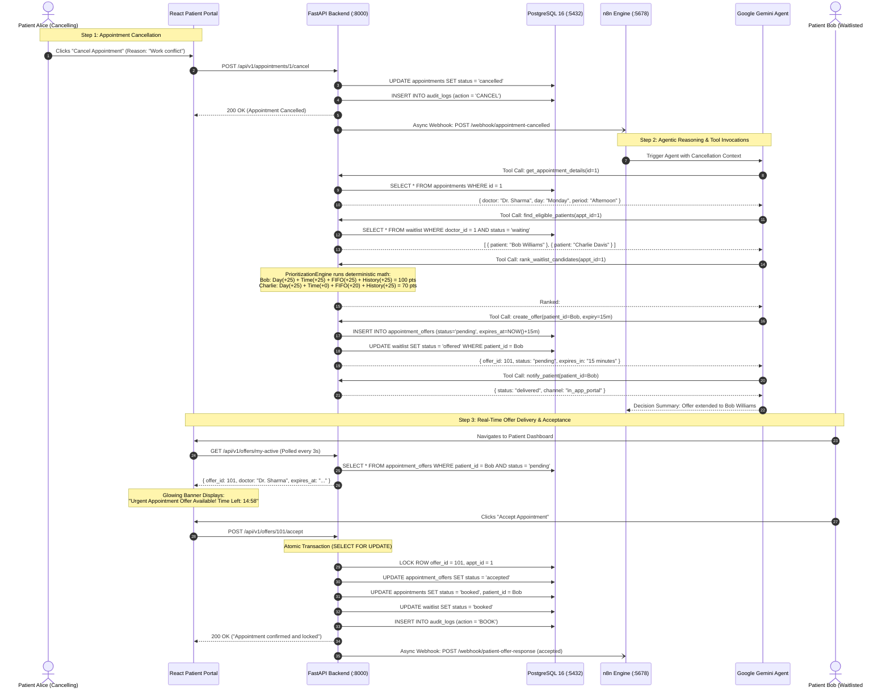

# CareFlow AI Hospital Scheduling Platform
## Complete Architecture, File Interconnections, Local n8n Guide & Senior Demonstration Script

---

## 1. Executive System Architecture

The **CareFlow AI Hospital Scheduling Platform** is an enterprise-grade, event-driven agentic healthcare platform. The system operates on an uncompromising design principle:

> **Separation of Authoritative State and Cognitive Reasoning:**  
> The Large Language Model (Google Gemini) **never** writes unrestricted SQL, **never** bypasses business rules, and **never** mutates database state directly. All database transactions, row-level locks, and priority scores are calculated deterministically by the authoritative backend core.

```
┌─────────────────────────────────────────────────────────────────────────────┐
│                      PRESENTATION LAYER (PORT 5173)                         │
│   React 18 + TypeScript + Vite + Tailwind CSS + Lucide Icons                │
│   ├── Patient Portal: Active Offer Countdown Banner (Polls every 3s)        │
│   ├── Doctor Scheduling & Appointment Cancellation Modal                    │
│   └── Admin Observability Command Center (Real-time Workflow Feeds)         │
└──────────────────────────────────────┬──────────────────────────────────────┘
                                       │ REST API (JSON / Bearer JWT)
                                       ▼
┌─────────────────────────────────────────────────────────────────────────────┐
│                   AUTHORITATIVE BACKEND CORE (PORT 8000)                    │
│   FastAPI 0.111 + SQLAlchemy 2.0 + Pydantic v2 + Uvicorn                    │
│   ├── Pure Python Prioritization Engine (4-Tier Deterministic Scoring)      │
│   ├── Concurrency Control: PostgreSQL SELECT FOR UPDATE Row Locks           │
│   ├── Unique Partial Constraints: uq_pending_offer_per_appointment          │
│   └── 9 Approved Agent Tools (/api/v1/agent/* protected by X-Agent-Secret)  │
└──────────────────────┬──────────────────────────────────────┬───────────────┘
                       │                                      │
  FastAPI Background   │                                      │ SQLAlchemy 2.0
  Async Webhook POST   │                                      │ Connection Pool
                       ▼                                      ▼
┌──────────────────────────────────────────────┐  ┌───────────────────────────┐
│       ORCHESTRATION ENGINE (PORT 5678)       │  │ AUTHORITATIVE DATABASE    │
│   Self-Hosted n8n Workflow Cluster           │  │ (PORT 5432)               │
│   ├── Workflow A: Cancellation Coordinator   │  │ PostgreSQL 16 Alpine      │
│   ├── Workflow B: Patient Offer Response     │  │ ├── hospital_core (Data)  │
│   ├── Workflow C: 1-Min Expiration Sweeper   │  │ └── hospital_n8n (Engine) │
│   └── Workflow D: Admin Failure Escalation   │  └───────────────────────────┘
└──────────────────────┬───────────────────────┘
                       │ LangChain Agent Node
                       │ Tool Call Invocations
                       ▼
┌──────────────────────────────────────────────┐
│           COGNITIVE AI LAYER                 │
│   Google Gemini 1.5 / 2.5 Flash              │
│   Autonomous Reasoning & Tool Selection      │
└──────────────────────────────────────────────┘
```

---

## 2. File Map & End-to-End Interconnections

The trace below maps how a patient event cascades through every single file in the repository:

```
[User Action in Browser]
      │
      ▼
1. frontend/src/pages/patient/Dashboard.tsx
      │  (User clicks "Cancel Appointment", enters reason)
      ▼
2. frontend/src/api/appointments.ts ──► frontend/src/api/client.ts
      │  (Axios attaches JWT Bearer token from localStorage)
      ▼
3. backend/app/api/v1/appointments.py (cancel_appointment)
      │  - Authenticates user via app/api/deps.py (get_current_user)
      │  - Sets appointment.status = CANCELLED
      │  - Logs audit entry via app/services/audit_service.py
      │  - Dispatches FastAPI BackgroundTask to app/services/webhook_service.py
      ▼
4. backend/app/services/webhook_service.py
      │  (Asynchronous HTTP POST to http://hospital_n8n:5678/webhook/appointment-cancelled)
      ▼
5. n8n/workflows/appointment_cancellation_coordinator.json
      │  (Webhook node receives event and feeds context to LangChain Agent)
      ▼
6. Google Gemini AI Agent Node (in n8n)
      │  Gemini reasons: "I must query slot details, find candidates, and rank them."
      │
      ├── Tool Call 1 ──► POST /api/v1/agent/appointment-details (agent_tools.py)
      ├── Tool Call 2 ──► POST /api/v1/agent/eligible-patients (agent_tools.py)
      ├── Tool Call 3 ──► POST /api/v1/agent/rank-candidates (agent_tools.py)
      │                         │
      │                         └──► app/services/prioritization_service.py
      │                              (Calculates +25 Day, +25 Time, +25 FIFO, +25 History)
      │
      ├── Tool Call 4 ──► POST /api/v1/agent/create-offer (agent_tools.py)
      │                         │
      │                         └──► app/services/offer_service.py (create_pending_offer)
      │                              (Creates 15-min offer; DB constraint guarantees uniqueness)
      │
      └── Tool Call 5 ──► POST /api/v1/agent/notify-patient (agent_tools.py)
                                │
                                └──► Logs audit event in audit_logs
      ▼
7. frontend/src/components/patient/ActiveOfferBanner.tsx
      │  (Polled every 3 seconds via frontend/src/api/offers.ts)
      │  - Detects active pending offer for Candidate #1
      │  - Renders glowing Teal Urgent Alert banner with live ticking timer (14:59... 14:58)
      ▼
8. Candidate Patient Clicks "Accept Offer" or "Decline Offer"
      │
      ├── ACCEPT:
      │   POST /api/v1/offers/{id}/accept
      │   └── app/services/offer_service.py (accept_offer_atomic)
      │       - SELECT ... FOR UPDATE (Row Lock on offer & appointment)
      │       - offer.status = ACCEPTED
      │       - appointment.status = BOOKED
      │       - Triggers n8n Workflow B to notify hospital systems
      │
      └── DECLINE / EXPIRE:
          POST /api/v1/offers/{id}/decline (or Workflow C 1-min cron sweeper)
          └── n8n Workflow B or C calls /api/v1/agent/next-candidate
              └── Candidate #2 receives Offer #2 immediately!
```

---

## 3. End-to-End Sequence Diagram



---

## 4. How n8n Runs Locally Without External Tunnels

### Why Did Earlier Setups Use Cloudflare Tunnels?
In cloud-hosted automation (e.g. n8n Cloud), the external cloud service cannot reach your local laptop's `http://localhost:8000` because private home IP addresses are behind NAT firewalls. Therefore, a Cloudflare Tunnel or ngrok was required to open a public inbound URL.

### How Does Local Docker Architecture Work?
In our Docker Compose environment:
1. **Isolated Bridge Network (`hospital_net`):** All 4 services run inside the same virtual network managed by Docker engine on your machine.
2. **Container DNS Resolution:** Docker provides automatic internal DNS. The backend container reaches n8n simply using `http://hospital_n8n:5678`. The n8n container reaches FastAPI using `http://hospital_backend:8000`.
3. **No Internet Tunnel Required:** All event dispatching happens in milliseconds directly over local virtual sockets inside your machine with zero external latency and zero cloud dependency.
4. **Host Port Forwarding:** Docker maps container ports to your Windows host:
   - React UI $\rightarrow$ `http://localhost:5173`
   - FastAPI Backend $\rightarrow$ `http://localhost:8000`
   - n8n Orchestrator $\rightarrow$ `http://localhost:5678`
   - PostgreSQL DB $\rightarrow$ `localhost:5432`

---

## 5. Step-by-Step n8n Setup Instructions

Follow these 4 simple steps to have n8n fully active on your computer:

### Step 1: Open n8n in Your Browser
Open your browser and navigate to:
👉 **[http://localhost:5678](http://localhost:5678)**

*(If launching for the first time, complete the quick 30-second setup by entering your name, email, and a password to create your free local admin account).*

---

### Step 2: Configure Your Google Gemini API Key in n8n
1. Get your free API key from **[Google AI Studio](https://aistudio.google.com/)** (click *Get API Key* $\rightarrow$ *Create API Key*).
2. In n8n, click **Credentials** on the left menu bar $\rightarrow$ Click **Add Credential** (top right).
3. Search for **Google Gemini** (or **Google PaLM / Gemini Chat Model**).
4. Paste your API key string and click **Save**.

---

### Step 3: Import the 4 Pre-Built Workflows
In the repository, navigate to `n8n/workflows/`:
1. In n8n, click **Workflows** in the left sidebar $\rightarrow$ Click **Add Workflow** (or the **+** icon).
2. Click the **Three Dots (...)** in the top-right corner of the canvas $\rightarrow$ Select **Import from File**.
3. Choose: `n8n/workflows/appointment_cancellation_coordinator.json`.
4. Double-click the **Google Gemini Model** node $\rightarrow$ In the **Credential** dropdown, select the credential you saved in Step 2.
5. In the top-right corner, toggle the workflow switch from **Inactive** to **Active** $\rightarrow$ Click **Save**.

Repeat Step 3 for the remaining 3 helper workflows:
- `patient_offer_response.json` (Handles accept/decline logic)
- `offer_expiration_monitor.json` (1-minute sweeper for expired offers)
- `failure_escalation.json` (Catches exceptions and alerts admin)

---

## 6. Senior Engineer Live Demonstration Script

Use this structured script when demonstrating the project to senior architects or technical interviewers.

### Act 1: The Problem & Architectural Justification (2 Minutes)
> **What to Say:**  
> *"In modern healthcare systems, last-minute appointment cancellations cost clinics millions in unused capacity while waitlists have months of backlog. Traditional solutions either rely on manual phone calls or dumb FIFO SMS broadcasts that cause race conditions.  
>  
> We built CareFlow AI using an **Agentic AI architecture**, but with an authoritative deterministic core. We deliberately avoided giving the LLM unrestricted access to the database. Instead, **FastAPI and PostgreSQL enforce ACID isolation and concurrency locks (`SELECT FOR UPDATE`)**, while **Google Gemini and n8n act as the cognitive orchestration layer**, analyzing slot parameters, querying eligible candidates, evaluating transparent deterministic score breakdowns, and coordinating patient offers."*

---

### Act 2: The Live Demonstration Walkthrough (3 Minutes)

#### Step 1: Open Two Browser Windows Side-by-Side
- **Left Window:** Logged in as **Alice Johnson** (`alice@example.com` / `Patient123!`) on `http://localhost:5173/patient/dashboard`.
- **Right Window (Incognito):** Logged in as **Bob Williams** (`bob@example.com` / `Patient123!`) on `http://localhost:5173/patient/dashboard`.

#### Step 2: Trigger Appointment Cancellation
1. In Alice's window, point out her scheduled appointment with **Dr. Rajesh Sharma** (Cardiology) for Monday 3:00 PM.
2. Click **"Cancel Appointment"** $\rightarrow$ Enter reason: *"Unexpected business travel"* $\rightarrow$ Click **"Confirm Cancellation"**.
3. Point out:
   > *"The moment Alice cancels, FastAPI commits the cancellation, logs an immutable audit event, and immediately dispatches an asynchronous background webhook to n8n."*

#### Step 3: Inspect the Live n8n Agent Execution
1. Switch to the n8n tab (`http://localhost:5678`) $\rightarrow$ Click **Executions**.
2. Open the live execution for **CareFlow - Appointment Cancellation Coordinator**.
3. Show the senior engineer the Gemini Agent node trace:
   > *"Notice how the Gemini agent systematically reasons:  
   > 1. It calls `get_appointment_details` to learn the doctor and time period.  
   > 2. It calls `find_eligible_patients` to pull the doctor's active waitlist.  
   > 3. It calls `rank_waitlist_candidates` to execute our deterministic scoring engine (+25 day match, +25 time period match, +25 seniority rank, +25 history fairness).  
   > 4. Bob Williams scored 100 points, so Gemini selected Bob and invoked `create_appointment_offer` with a 15-minute lock."*

#### Step 4: Show the Real-Time Offer on Bob's Dashboard
1. Switch back to **Bob Williams's window** on `http://localhost:5173`.
2. Show the glowing **Teal Urgent Alert Banner**:
   - Doctor: *Dr. Rajesh Sharma (Cardiology)*
   - Slot Time: *Monday at 3:00 PM*
   - Live Countdown: *14:45... 14:44...*
3. Point out:
   > *"Bob's portal has detected the urgent offer via our reactive banner. Notice the live countdown timer. If Bob accepts, the slot is locked immediately. If Bob declines or lets the timer hit zero, Workflow B/C triggers immediately and re-allocates the slot to Candidate #2 (Charlie Davis)."*

#### Step 5: Accept the Offer & Verify Database Lock
1. Click **"Accept Offer"**.
2. Show the instant confirmation notice: *"Appointment successfully confirmed and locked."*
3. Show that Alice's vacated slot is now booked by Bob, and Bob's waitlist entry is converted to `booked`.

---

### Act 3: Anticipated Senior Technical Questions & Answers

#### Q1: "Why did you use n8n instead of purely Python code with LangGraph?"
> **Answer:** *"n8n provides visual observability, error recovery, built-in retry logic, and zero-code workflow edits for clinic operators. However, we decoupled all business logic from n8n: n8n simply coordinates tool calls to FastAPI endpoints. If we ever want to swap n8n for LangGraph or Temporal, our backend contracts remain 100% identical."*

#### Q2: "How do you prevent two patients from booking the exact same cancelled slot?"
> **Answer:** *"At two independent layers:  
> 1. **Database engine layer:** PostgreSQL enforces a partial unique index `uq_pending_offer_per_appointment` on `appointment_offers` where `status = 'pending'`. The DB will raise a 409 Conflict if two offers are created simultaneously.  
> 2. **Transaction layer:** When a patient accepts an offer, `accept_offer_atomic()` executes `SELECT ... FOR UPDATE` row-level locks on both the offer row and appointment slot. Any concurrent request must wait for the transaction commit and will immediately receive a 400 Bad Request indicating the slot is already booked."*

#### Q3: "What prevents Gemini from hallucinating an offer or modifying patient scores?"
> **Answer:** *"Gemini has zero write privileges on the database and no ability to compute scores. Scoring is executed exclusively in pure Python by `PrioritizationEngine.rank_candidates()`. Gemini only receives the ranked list and invokes our pre-validated `create_offer` tool. Any invalid payload is caught by Pydantic v2 schemas and rejected with HTTP 422."*

